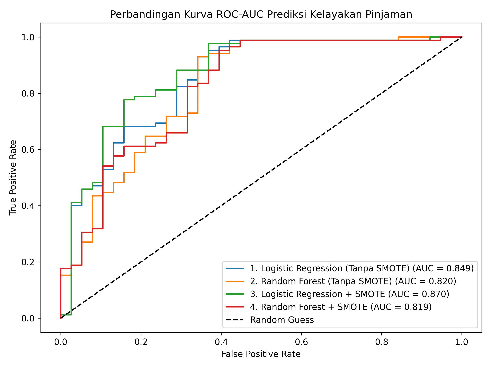
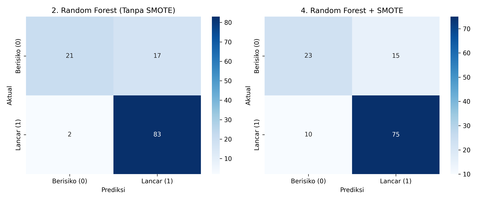

# Komparasi Algoritma Random Forest dan Logistic Regression dengan Teknik SMOTE untuk Prediksi Risiko Gagal Bayar Pinjaman

**Dimas Galih Giovan**  
Program Studi Informatika, UPN "Veteran" Jawa Timur  
Email: 23081010169@student.ac.id

---

## Abstrak
Ketidakseimbangan distribusi kelas (*class imbalance*) pada data historis pengajuan kredit sering menyebabkan algoritma klasifikasi gagal mendeteksi pemohon berisiko tinggi. Penelitian ini membandingkan kinerja algoritma linear (*Logistic Regression*) dan berbasis pohon (*Random Forest*) dalam memprediksi risiko kelayakan pinjaman menggunakan dataset *Loan Prediction* (614 data pengajuan dengan proporsi 68,73% disetujui dan 31,27% ditolak/berisiko). Teknik *Synthetic Minority Over-sampling Technique* (SMOTE) diterapkan secara ketat pada data latih setelah pemisahan rasio 80:20 untuk mencegah kebocoran data (*data leakage*). Hasil pengujian menunjukkan bahwa penerapan SMOTE meningkatkan sensitivitas (*Recall*) deteksi kelas berisiko dari **0,5789 menjadi 0,6579** pada *Logistic Regression* serta dari **0,5526 menjadi 0,6053** pada *Random Forest*. Skenario **Logistic Regression + SMOTE** mencapai kemampuan pemisahan kelas terbaik dengan nilai **ROC-AUC sebesar 0,8703**, sedangkan **Logistic Regression tanpa SMOTE** mempertahankan **Accuracy tertinggi sebesar 0,8618** dan **F1-Score sebesar 0,7213**.

**Kata Kunci:** *Credit Risk Prediction, Imbalanced Data, Logistic Regression, Random Forest, SMOTE.*

---

## I. Pendahuluan
Perkembangan layanan keuangan digital menuntut proses evaluasi kelayakan kredit yang cepat dan akurat. Pada data historis pengajuan pinjaman, jumlah pemohon dengan status lancar umumnya mendominasi dibandingkan pemohon yang ditolak atau berisiko gagal bayar. Ketimpangan distribusi kelas ini menyebabkan algoritma klasifikasi standar cenderung memprediksi kelas mayoritas, sehingga tingkat kesalahan deteksi pada kelas berisiko (*False Negative*) menjadi tinggi.

Penelitian ini bertujuan mengukur efektivitas penerapan metode *oversampling* SMOTE yang dikombinasikan dengan komparasi algoritma *Logistic Regression* dan *Random Forest* untuk meningkatkan kemampuan deteksi kelas minoritas secara akurat tanpa menimbulkan kebocoran data.

---

## II. Tinjauan Pustaka & Research Gap
Studi terdahulu oleh Kumar et al. (2022) menguji algoritma *Decision Tree* dan *Naive Bayes* pada data pengajuan pinjaman tanpa penanganan ketidakseimbangan data, sehingga menghasilkan nilai *Recall* yang rendah pada kelas ditolak. Sementara itu, Rahman et al. (2024) menerapkan penyeimbangan data sebelum proses *train-test split*, yang berpotensi menyebabkan sampel sintetis masuk ke data uji (*data leakage*). Penelitian ini mengatasi celah tersebut dengan menerapkan SMOTE secara eksklusif pada data latih setelah pemisahan data serta mengevaluasi kinerja model menggunakan metrik *Precision, Recall, F1-Score,* dan *ROC-AUC*.

---

## III. Metodologi Penelitian
1. **Dataset:** Menggunakan dataset publik *Loan Prediction* berjumlah 614 baris dan 13 atribut (422 kelas `Y` / lancar dan 192 kelas `N` / berisiko).
2. **Preprocessing:** Menghapus kolom `Loan_ID`, melakukan imputasi nilai kosong menggunakan modus untuk atribut kategorikal dan median untuk `LoanAmount`, mengonversi nilai `'3+'` pada `Dependents` menjadi numerik, melakukan pengkodean biner serta *One-Hot Encoding* pada `Property_Area`, dan menormalisasi fitur menggunakan `StandardScaler`.
3. **Splitting & SMOTE:** Dataset dipartisi menggunakan *stratified split* sebesar 80% data latih (491 sampel) dan 20% data uji (123 sampel). SMOTE diterapkan hanya pada data latih hingga jumlah kedua kelas seimbang (337 sampel lancar dan 337 sampel berisiko).
4. **Pemodelan & Evaluasi:** Pengujian dilakukan dalam empat skenario (tanpa dan dengan SMOTE pada *Logistic Regression* serta *Random Forest*) dan dievaluasi menggunakan *Accuracy, Precision, Recall, F1-Score* (kelas berisiko), serta *ROC-AUC*.

---

## IV. Hasil dan Pembahasan
Pengujian terhadap 123 sampel data uji menghasilkan perbandingan metrik evaluasi sebagaimana ditampilkan pada Tabel 1.

**Tabel 1. Perbandingan Kinerja Model pada Data Uji**

| Skenario Model | Accuracy | Precision (Risiko) | Recall (Risiko) | F1-Score (Risiko) | ROC-AUC |
| :--- | :---: | :---: | :---: | :---: | :---: |
| 1. Logistic Regression (Tanpa SMOTE) | **0,8618** | **0,9565** | 0,5789 | **0,7213** | 0,8486 |
| 2. Random Forest (Tanpa SMOTE) | 0,8455 | 0,9130 | 0,5526 | 0,6885 | 0,8195 |
| **3. Logistic Regression + SMOTE** | 0,8130 | 0,7143 | **0,6579** | 0,6849 | **0,8703** |
| 4. Random Forest + SMOTE | 0,7967 | 0,6970 | 0,6053 | 0,6479 | 0,8189 |

**Gambar 1. Perbandingan Kurva ROC-AUC Keempat Skenario Model**

**Gambar 2. Perbandingan Confusion Matrix Sebelum dan Sesudah SMOTE**

Berdasarkan Tabel 1, diperoleh tiga temuan utama:
1. **Peningkatan Sensitivitas (*Recall*) Kelas Berisiko:** Sebelum penerapan SMOTE, kedua model memiliki nilai *Recall* yang rendah (0,5789 pada *Logistic Regression* dan 0,5526 pada *Random Forest*), yang berarti lebih dari 42% pengajuan berisiko gagal terdeteksi. Setelah penerapan SMOTE, *Recall* meningkat signifikan menjadi **0,6579** pada *Logistic Regression* (+7,90%) dan **0,6053** pada *Random Forest* (+5,27%).
2. **Fenomena *Precision-Recall Trade-off*:** Kenaikan *Recall* setelah SMOTE diikuti oleh penurunan *Precision* (dari 0,9565 menjadi 0,7143 pada *Logistic Regression*) dan *Accuracy* (dari 0,8618 menjadi 0,8130). Hal ini terjadi karena pergeseran batas keputusan (*decision boundary*) membuat model lebih agresif menandai pengajuan yang meragukan sebagai kelas berisiko.
3. **Keunggulan Model Linear pada Dataset Kecil:** *Logistic Regression* mengungguli *Random Forest* pada seluruh skenario. Pada dataset berdimensi kecil (614 baris), model linear memiliki generalisasi yang lebih stabil dibandingkan *Random Forest* yang cenderung lebih sensitif terhadap variasi sampel sintetis hasil interpolasi SMOTE.

---

## V. Kesimpulan dan Saran
Penerapan teknik SMOTE secara terisolasi pada data latih terbukti efektif meningkatkan *Recall* dalam mendeteksi risiko gagal bayar pinjaman serta meningkatkan nilai *ROC-AUC* pada model linear. Untuk skenario yang memprioritaskan minimalisasi risiko gagal bayar dan pemisahan probabilitas terbaik, kombinasi **Logistic Regression + SMOTE** direkomendasikan dengan capaian **Recall 0,6579** dan **ROC-AUC 0,8703**. Sebaliknya, jika institusi memprioritaskan ketepatan persetujuan (*Precision* 0,9565) dan keseimbangan umum (*F1-Score* 0,7213), **Logistic Regression tanpa SMOTE** memberikan hasil paling optimal. Penelitian selanjutnya dapat mengeksplorasi penyesuaian ambang batas probabilitas (*threshold tuning*) dan metode *hybrid resampling* seperti SMOTE-Tomek.

---

## Daftar Pustaka
1. Chawla, N. V., Bowyer, K. W., Hall, L. O., & Kegelmeyer, W. P. (2002). SMOTE: Synthetic Minority Over-sampling Technique. *Journal of Artificial Intelligence Research*, 16, 321–357.
2. Breiman, L. (2001). Random Forests. *Machine Learning*, 45(1), 5–32.
3. Kaggle. (2023). *Loan Prediction Problem Dataset*. Diakses dari `https://www.kaggle.com/datasets/altruistdelhite04/loan-prediction-problem-dataset`.
