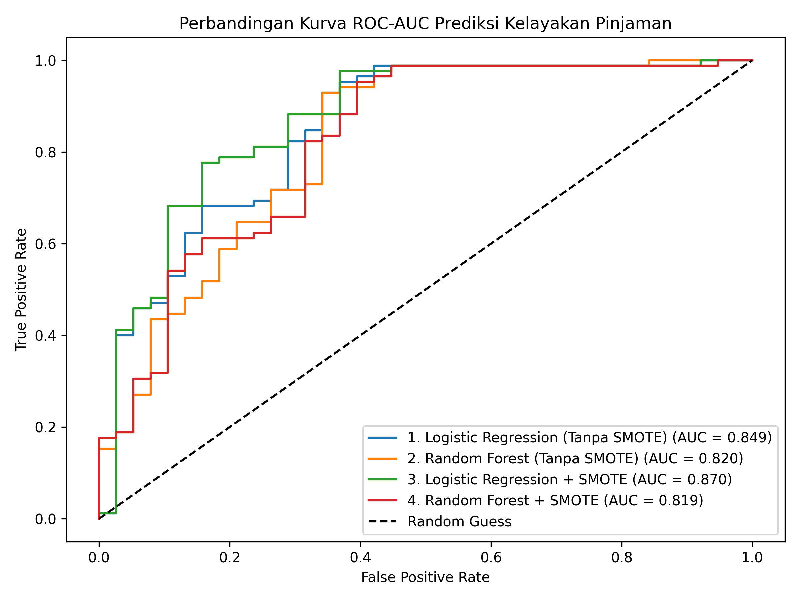
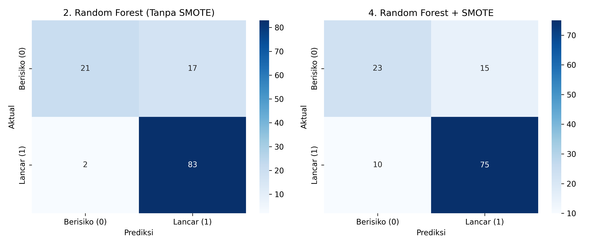

# Materi Presentasi UAS: Komparasi Algoritma Random Forest dan Logistic Regression dengan Teknik SMOTE untuk Prediksi Risiko Gagal Bayar Pinjaman

---

## Slide 1: Halaman Judul
* **Judul Riset:** Komparasi Algoritma *Random Forest* dan *Logistic Regression* dengan Teknik SMOTE untuk Prediksi Risiko Gagal Bayar Pinjaman
* **Nama:** Dimas Galih Giovan
* **NPM:** 23081010169
* **Mata Kuliah:** Riset Informatika

---

## Slide 2: Latar Belakang & Rumusan Masalah
* **Latar Belakang:**
  * Data historis pengajuan kredit umumnya tidak seimbang (*imbalanced*), di mana pengajuan lancar (`68,73%`) mendominasi dibandingkan pengajuan berisiko/ditolak (`31,27%`).
  * Model *Machine Learning* standar cenderung bias ke kelas mayoritas sehingga banyak kasus berisiko gagal terdeteksi (*False Negative* tinggi).
* **Rumusan Masalah:**
  1. Bagaimana pengaruh penerapan **SMOTE** dalam meningkatkan sensitivitas deteksi kelas berisiko pada data pinjaman?
  2. Bagaimana perbandingan kinerja **Logistic Regression** dan **Random Forest** sebelum dan sesudah penerapan SMOTE?

---

## Slide 3: Research Gap & Kontribusi Penelitian
* **Keterbatasan Penelitian Terdahulu:**
  * Sebagian studi tidak menangani ketimpangan kelas (*imbalanced data*), sehingga nilai *Recall* pada kelas berisiko rendah.
  * Beberapa penelitian melakukan *oversampling* sebelum *train-test split*, yang memicu kebocoran data (*data leakage*).
* **Kontribusi Riset Ini:**
  * Menerapkan **SMOTE secara ketat hanya pada data latih** setelah *stratified split* (80:20).
  * Mengevaluasi komparasi model linear (*Logistic Regression*) dan *ensemble* (*Random Forest*) menggunakan metrik spesifik kelas minoritas (*Precision, Recall, F1-Score,* dan *ROC-AUC*).

---

## Slide 4: Dataset & Tahapan Preprocessing
* **Sumber Dataset:** Kaggle *Loan Prediction Problem Dataset* (**614 baris**, **13 atribut**).
* **Tahapan Preprocessing (`loan_data_cleaned.csv`):**
  1. Menghapus atribut identitas `Loan_ID`.
  2. Imputasi *missing values* menggunakan **modus** (fitur kategorikal) dan **median** (`LoanAmount`).
  3. Mengubah fitur kategorikal menjadi numerik (*Binary Mapping* & *One-Hot Encoding*).
  4. Normalisasi skala fitur dengan `StandardScaler`.

---

## Slide 5: Skenario Eksperimen & Penerapan SMOTE
* **Pembagian Data (*Stratified Split* 80:20):**
  * **Data Latih:** 491 sampel (337 Lancar vs 154 Berisiko).
  * **Data Uji:** 123 sampel (85 Lancar vs 38 Berisiko — dibiarkan murni tanpa SMOTE).
* **Dampak SMOTE pada Data Latih:**
  * Menyeimbangkan kelas latih menjadi **337 Lancar : 337 Berisiko (50:50)**.
* **4 Skenario Pengujian:**
  1. *Logistic Regression* (Tanpa SMOTE)
  2. *Random Forest* (Tanpa SMOTE)
  3. *Logistic Regression* + SMOTE
  4. *Random Forest* + SMOTE

---

## Slide 6: Hasil Pengujian Model (123 Data Uji)

| Skenario Model | Accuracy | Precision (Risiko) | Recall (Risiko) | F1-Score (Risiko) | ROC-AUC |
| :--- | :---: | :---: | :---: | :---: | :---: |
| 1. Logistic Regression (Tanpa SMOTE) | **0,8618** | **0,9565** | 0,5789 | **0,7213** | 0,8486 |
| 2. Random Forest (Tanpa SMOTE) | 0,8455 | 0,9130 | 0,5526 | 0,6885 | 0,8195 |
| **3. Logistic Regression + SMOTE** | 0,8130 | 0,7143 | **0,6579** | 0,6849 | **0,8703** |
| 4. Random Forest + SMOTE | 0,7967 | 0,6970 | 0,6053 | 0,6479 | 0,8189 |

### Visualisasi Kurva ROC-AUC & Confusion Matrix

---

## Slide 7: Analisis Temuan Utama
1. **Peningkatan Sensitivitas (*Recall*) Kelas Berisiko:**
   * SMOTE meningkatkan *Recall* deteksi risiko pada *Logistic Regression* dari `0,5789` menjadi **`0,6579`** (+7,90%) dan pada *Random Forest* dari `0,5526` menjadi **`0,6053`** (+5,27%).
2. **Fenomena *Precision-Recall Trade-off*:**
   * Peningkatan *Recall* diikuti penurunan *Precision* dan *Accuracy* karena model menjadi lebih ketat menyaring pengajuan yang meragukan.
3. **Keunggulan Model Linear pada Dataset Kecil:**
   * *Logistic Regression* lebih unggul dibanding *Random Forest* di seluruh skenario karena memiliki generalisasi lebih stabil pada dataset berukuran 614 baris.

---

## Slide 8: Kesimpulan & Saran
* **Kesimpulan:**
  * Jika prioritas utama adalah **meminimalkan risiko gagal bayar** dan pemisahan probabilitas terbaik $\rightarrow$ gunakan **Logistic Regression + SMOTE** (*Recall* `0,6579`, *ROC-AUC* `0,8703`).
  * Jika prioritas utama adalah **akurasi keseluruhan dan ketepatan persetujuan** $\rightarrow$ gunakan **Logistic Regression Tanpa SMOTE** (*Accuracy* `0,8618`, *F1-Score* `0,7213`).
* **Saran Pengembangan:**
  * Eksplorasi *threshold tuning* (penyesuaian ambang probabilitas prediksi) dan metode *hybrid resampling* (SMOTE-Tomek).
